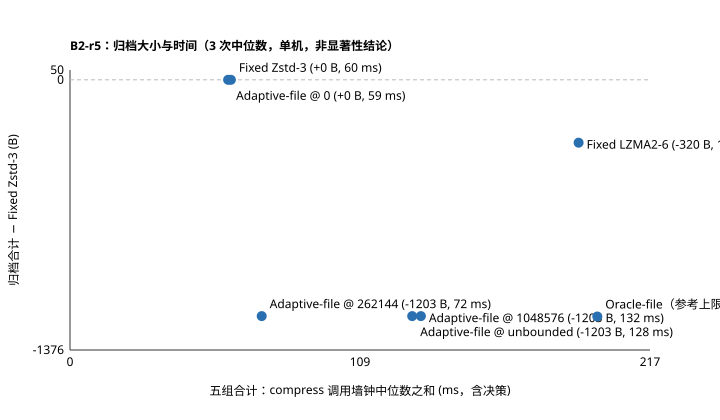

# B2-r5 P0 结果（由 b2_adaptive.py 从 raw.json 生成）

共 195 次 compress → verify → extract，全部逐字节还原，同组归档 SHA256 一致、决策一致。
P0-A：8 个 r4 原方案与 Oracle-file（对 r4 B2-file-codec）共 45 组归档 SHA256 与 B2-r4 相同。
时间为工具内 compress 调用（不含进程启动与 JSON 输出）的中位数；CPU 为进程/线程 user+kernel，Windows 计时粒度约 15.6 ms，毫秒级 CPU 值只作量级参考。

## 完整归档字节

| 数据 | Fixed Zstd-3 | Fixed LZMA2-6 | Adaptive-file @ 0 | Adaptive-file @ 262144 | Adaptive-file @ 1048576 | Adaptive-file @ unbounded | Oracle-file（参考上限） |
| --- | ---: | ---: | ---: | ---: | ---: | ---: | ---: |
| binary | 393646 | 393646 | 393646 | 393646 | 393646 | 393646 | 393646 |
| compressed | 393834 | 393834 | 393834 | 393834 | 393834 | 393834 | 393834 |
| mixed | 394959 | 395403 | 394959 | 394959 | 394959 | 394959 | 394959 |
| source | 9503 | 8304 | 9503 | 8300 | 8300 | 8300 | 8298 |
| text | 944 | 1379 | 944 | 944 | 944 | 944 | 944 |
| **合计** | **1192886** | **1192566** | **1192886** | **1191683** | **1191683** | **1191683** | **1191681** |

## 成本（每数据集中位数，ms）

| 数据 | 方案 | 候选数 | 试编码输入 B | 预算耗尽文件 | 决策墙钟 | 决策 CPU | 最终编码墙钟 | 合计墙钟 | 合计 CPU | 解压墙钟 | 压缩峰值 MiB | 解压峰值 MiB |
| --- | --- | ---: | ---: | ---: | ---: | ---: | ---: | ---: | ---: | ---: | ---: | ---: |
| binary | Fixed Zstd-3 | 0 | 0 | 0 | 0.00 | 0.0 | 14.62 | 14.62 | 15.6 | 17.96 | 7.61 | 6.97 |
| binary | Fixed LZMA2-6 | 0 | 0 | 0 | 0.00 | 0.0 | 52.34 | 52.34 | 46.9 | 18.55 | 8.23 | 6.96 |
| binary | Adaptive-file @ 0 | 0 | 0 | 1 | 0.10 | 0.0 | 14.30 | 14.41 | 15.6 | 18.56 | 7.63 | 6.94 |
| binary | Adaptive-file @ 262144 | 0 | 0 | 1 | 0.12 | 0.0 | 14.44 | 14.60 | 15.6 | 18.30 | 7.63 | 6.96 |
| binary | Adaptive-file @ 1048576 | 6 | 393216 | 0 | 20.56 | 15.6 | 15.69 | 36.26 | 31.2 | 18.40 | 8.86 | 6.96 |
| binary | Adaptive-file @ unbounded | 6 | 393216 | 0 | 18.32 | 15.6 | 14.73 | 33.05 | 31.2 | 17.85 | 8.91 | 6.93 |
| binary | Oracle-file（参考上限） | 18 | 1179648 | 0 | 36.09 | 31.2 | 15.21 | 50.40 | 46.9 | 18.79 | 9.45 | 6.96 |
| compressed | Fixed Zstd-3 | 0 | 0 | 0 | 0.00 | 0.0 | 15.20 | 15.20 | 15.6 | 17.97 | 7.63 | 6.95 |
| compressed | Fixed LZMA2-6 | 0 | 0 | 0 | 0.00 | 0.0 | 51.42 | 51.42 | 62.5 | 18.03 | 8.23 | 6.95 |
| compressed | Adaptive-file @ 0 | 0 | 0 | 1 | 0.13 | 0.0 | 14.51 | 14.64 | 15.6 | 18.10 | 7.64 | 6.95 |
| compressed | Adaptive-file @ 262144 | 0 | 0 | 1 | 0.13 | 0.0 | 15.60 | 15.73 | 15.6 | 18.92 | 7.64 | 6.96 |
| compressed | Adaptive-file @ 1048576 | 6 | 262426 | 0 | 12.11 | 15.6 | 15.31 | 27.75 | 31.2 | 18.90 | 8.80 | 6.96 |
| compressed | Adaptive-file @ unbounded | 6 | 262426 | 0 | 12.31 | 15.6 | 15.46 | 27.77 | 31.2 | 18.33 | 8.80 | 6.96 |
| compressed | Oracle-file（参考上限） | 21 | 1180071 | 0 | 37.45 | 46.9 | 15.33 | 52.88 | 62.5 | 19.00 | 9.45 | 6.96 |
| mixed | Fixed Zstd-3 | 0 | 0 | 0 | 0.00 | 0.0 | 19.82 | 19.82 | 15.6 | 39.41 | 7.70 | 7.05 |
| mixed | Fixed LZMA2-6 | 0 | 0 | 0 | 0.00 | 0.0 | 64.41 | 64.41 | 62.5 | 37.77 | 8.24 | 7.04 |
| mixed | Adaptive-file @ 0 | 0 | 0 | 2 | 0.32 | 0.0 | 18.88 | 19.20 | 15.6 | 37.31 | 7.71 | 7.07 |
| mixed | Adaptive-file @ 262144 | 0 | 0 | 2 | 0.33 | 0.0 | 19.84 | 20.17 | 15.6 | 37.49 | 7.71 | 7.06 |
| mixed | Adaptive-file @ 1048576 | 15 | 983040 | 0 | 22.80 | 31.2 | 19.74 | 42.79 | 46.9 | 38.13 | 9.64 | 7.06 |
| mixed | Adaptive-file @ unbounded | 15 | 983040 | 0 | 23.26 | 31.2 | 19.41 | 42.66 | 46.9 | 38.89 | 9.64 | 7.06 |
| mixed | Oracle-file（参考上限） | 42 | 2363688 | 0 | 46.29 | 46.9 | 19.04 | 65.33 | 78.1 | 36.80 | 9.48 | 7.06 |
| source | Fixed Zstd-3 | 0 | 0 | 0 | 0.00 | 0.0 | 4.06 | 4.06 | 0.0 | 7.08 | 7.57 | 7.05 |
| source | Fixed LZMA2-6 | 0 | 0 | 0 | 0.00 | 0.0 | 9.83 | 9.83 | 15.6 | 7.34 | 7.90 | 6.93 |
| source | Adaptive-file @ 0 | 0 | 0 | 1 | 0.21 | 0.0 | 3.65 | 3.87 | 0.0 | 6.76 | 7.57 | 6.96 |
| source | Adaptive-file @ 262144 | 3 | 102108 | 0 | 5.47 | 0.0 | 8.61 | 14.08 | 15.6 | 7.05 | 8.40 | 7.01 |
| source | Adaptive-file @ 1048576 | 3 | 102108 | 0 | 5.60 | 15.6 | 8.58 | 14.18 | 15.6 | 6.80 | 8.40 | 7.02 |
| source | Adaptive-file @ unbounded | 3 | 102108 | 0 | 5.74 | 0.0 | 8.63 | 14.45 | 15.6 | 6.85 | 8.40 | 7.02 |
| source | Oracle-file（参考上限） | 9 | 105108 | 0 | 6.23 | 15.6 | 8.99 | 14.97 | 15.6 | 7.14 | 8.84 | 7.00 |
| text | Fixed Zstd-3 | 0 | 0 | 0 | 0.00 | 0.0 | 6.62 | 6.62 | 15.6 | 17.97 | 7.56 | 7.00 |
| text | Fixed LZMA2-6 | 0 | 0 | 0 | 0.00 | 0.0 | 12.69 | 12.69 | 15.6 | 18.25 | 8.18 | 6.98 |
| text | Adaptive-file @ 0 | 0 | 0 | 1 | 0.13 | 0.0 | 7.03 | 7.16 | 0.0 | 18.87 | 7.57 | 6.99 |
| text | Adaptive-file @ 262144 | 0 | 0 | 1 | 0.16 | 0.0 | 7.15 | 7.31 | 15.6 | 18.30 | 7.58 | 7.00 |
| text | Adaptive-file @ 1048576 | 9 | 589824 | 0 | 3.64 | 0.0 | 7.02 | 10.58 | 15.6 | 18.03 | 8.81 | 7.00 |
| text | Adaptive-file @ unbounded | 9 | 589824 | 0 | 3.39 | 0.0 | 6.88 | 10.35 | 0.0 | 17.95 | 8.82 | 7.00 |
| text | Oracle-file（参考上限） | 18 | 1179648 | 0 | 6.51 | 0.0 | 7.24 | 14.09 | 15.6 | 19.10 | 9.31 | 6.99 |

## 五组合计（大小—时间）

| 方案 | 归档合计 B | 相对 Zstd-3 | 候选 | 试编码输入 B | 决策墙钟 ms | 合计墙钟 ms |
| --- | ---: | ---: | ---: | ---: | ---: | ---: |
| Fixed Zstd-3 | 1192886 | +0 | 0 | 0 | 0.00 | 60.32 |
| Fixed LZMA2-6 | 1192566 | -320 | 0 | 0 | 0.00 | 190.69 |
| Adaptive-file @ 0 | 1192886 | +0 | 0 | 0 | 0.89 | 59.27 |
| Adaptive-file @ 262144 | 1191683 | -1203 | 3 | 102108 | 6.22 | 71.89 |
| Adaptive-file @ 1048576 | 1191683 | -1203 | 39 | 2330614 | 64.72 | 131.55 |
| Adaptive-file @ unbounded | 1191683 | -1203 | 39 | 2330614 | 63.01 | 128.29 |
| Oracle-file（参考上限） | 1191681 | -1205 | 108 | 6008163 | 132.57 | 197.68 |

## Adaptive-file 决策

| 数据 | 预算档 | file_key | 选择 | decision_reason | notes | 抽样块 |
| --- | --- | --- | --- | --- | --- | --- |
| binary | 0 | binary.bin | zstd3 | budget_exhausted | — | — |
| binary | 262144 | binary.bin | zstd3 | budget_exhausted | — | — |
| binary | 1048576 | binary.bin | zstd3 | no_gain | — | 0,3,5 |
| binary | unbounded | binary.bin | zstd3 | no_gain | — | 0,3,5 |
| compressed | 0 | packed.gz | zstd3 | budget_exhausted | — | — |
| compressed | 262144 | packed.gz | zstd3 | budget_exhausted | — | — |
| compressed | 1048576 | packed.gz | zstd3 | no_gain | — | 0,3,6 |
| compressed | unbounded | packed.gz | zstd3 | no_gain | — | 0,3,6 |
| mixed | 0 | 000-text.txt | zstd3 | budget_exhausted | — | — |
| mixed | 0 | sub/binary.bin | zstd3 | budget_exhausted | — | — |
| mixed | 0 | sub/empty | zstd3 | empty_file | — | — |
| mixed | 0 | sub/packed.gz | zstd3 | below_min_size | — | — |
| mixed | 0 | unicode/中文.txt | zstd3 | below_min_size | — | — |
| mixed | 262144 | 000-text.txt | zstd3 | budget_exhausted | — | — |
| mixed | 262144 | sub/binary.bin | zstd3 | budget_exhausted | — | — |
| mixed | 262144 | sub/empty | zstd3 | empty_file | — | — |
| mixed | 262144 | sub/packed.gz | zstd3 | below_min_size | — | — |
| mixed | 262144 | unicode/中文.txt | zstd3 | below_min_size | — | — |
| mixed | 1048576 | 000-text.txt | zstd3 | insufficient_gain | — | 0,3,5 |
| mixed | 1048576 | sub/binary.bin | zstd3 | no_gain | — | 0,3,5 |
| mixed | 1048576 | sub/empty | zstd3 | empty_file | — | — |
| mixed | 1048576 | sub/packed.gz | zstd3 | below_min_size | — | — |
| mixed | 1048576 | unicode/中文.txt | zstd3 | below_min_size | — | — |
| mixed | unbounded | 000-text.txt | zstd3 | insufficient_gain | — | 0,3,5 |
| mixed | unbounded | sub/binary.bin | zstd3 | no_gain | — | 0,3,5 |
| mixed | unbounded | sub/empty | zstd3 | empty_file | — | — |
| mixed | unbounded | sub/packed.gz | zstd3 | below_min_size | — | — |
| mixed | unbounded | unicode/中文.txt | zstd3 | below_min_size | — | — |
| source | 0 | checked_arithmetic.cpp | zstd3 | below_min_size | — | — |
| source | 0 | store_archive.cpp | zstd3 | budget_exhausted | — | — |
| source | 0 | version.cpp | zstd3 | below_min_size | — | — |
| source | 262144 | checked_arithmetic.cpp | zstd3 | below_min_size | — | — |
| source | 262144 | store_archive.cpp | lzma26 | lzma2_6_saves | — | 0 |
| source | 262144 | version.cpp | zstd3 | below_min_size | — | — |
| source | 1048576 | checked_arithmetic.cpp | zstd3 | below_min_size | — | — |
| source | 1048576 | store_archive.cpp | lzma26 | lzma2_6_saves | — | 0 |
| source | 1048576 | version.cpp | zstd3 | below_min_size | — | — |
| source | unbounded | checked_arithmetic.cpp | zstd3 | below_min_size | — | — |
| source | unbounded | store_archive.cpp | lzma26 | lzma2_6_saves | — | 0 |
| source | unbounded | version.cpp | zstd3 | below_min_size | — | — |
| text | 0 | text.txt | zstd3 | budget_exhausted | — | — |
| text | 262144 | text.txt | zstd3 | budget_exhausted | — | — |
| text | 1048576 | text.txt | zstd3 | insufficient_gain | — | 0,3,5 |
| text | unbounded | text.txt | zstd3 | insufficient_gain | — | 0,3,5 |

## 预先登记假设

- H1（各档不大于 Zstd-3）：成立
- H2（无界档与 Oracle 差距 ≤ Oracle 节省量一半）：binary 成立，compressed 成立，mixed 成立，source 成立，text 成立
